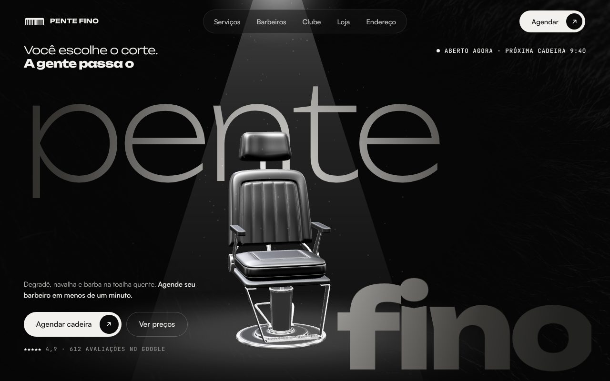
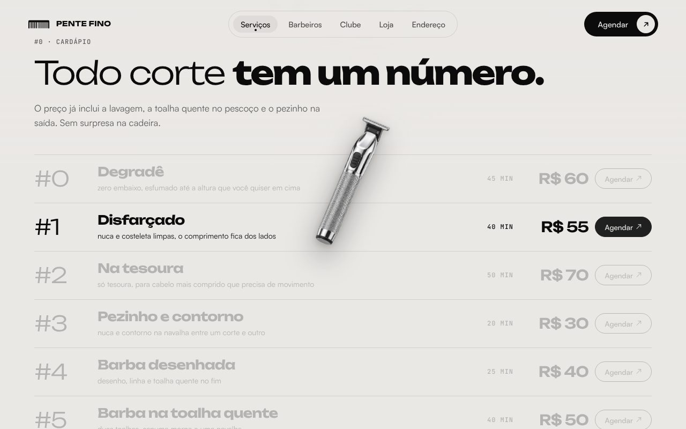
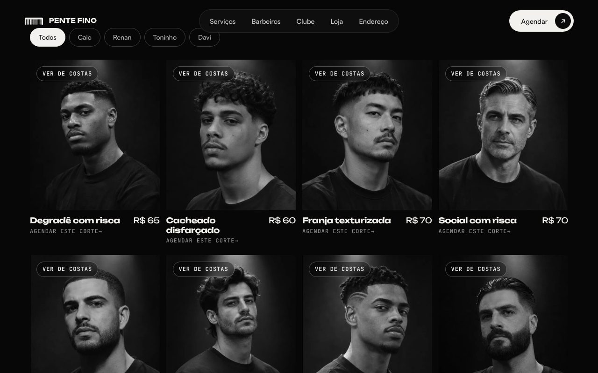

# Barbearia · agendamento online

App de agendamento para barbearias: o cliente encontra barbearias, vê os serviços e preços e marca um horário.

> Projeto de estudo, em desenvolvimento.

## Landing page (no ar)

A pasta [`landing/`](landing) tem a landing page da barbearia, com cadeira em 3D (Three.js), animações com GSAP e botões de agendamento que abrem o WhatsApp.

**No ar:** https://barbearia.eduardotorres-dev.com.br

 
 

## O que já tem

- **Página inicial** com busca, atalhos por serviço (cabelo, barba, massagem, hidratação…) e listas de barbearias recomendadas e populares, vindas do banco.
- **Cartão de agendamento** (layout pronto, ainda com dados fixos).
- **Rota da barbearia** (`/barbershops/[id]`) já buscando os dados no banco; o layout está em construção.
- **Banco de dados** modelado com Prisma: usuários, barbearias, serviços, agendamentos e avaliações, com *seed* de dados de exemplo.

## Próximos passos

- Login de clientes
- Página da barbearia com serviços e preços
- Fluxo de reserva com escolha de data e horário
- Lista de agendamentos do cliente
- Avaliações

## Tecnologias

Next.js (App Router) · React · TypeScript · Tailwind CSS · shadcn/ui · Prisma · PostgreSQL · ESLint, Prettier, Husky e lint-staged

## Rodar localmente

```bash
npm install
# .env: DATABASE_URL=postgresql://...
npx prisma migrate dev
npx prisma db seed
npm run dev   # http://localhost:3000
```
